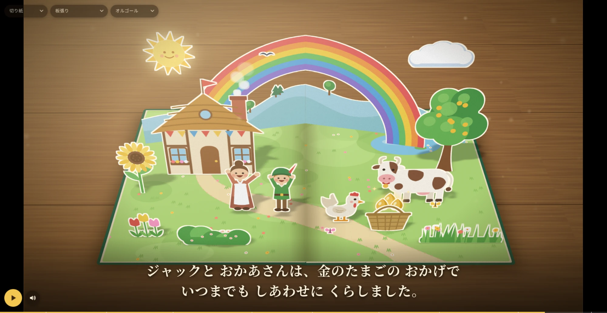
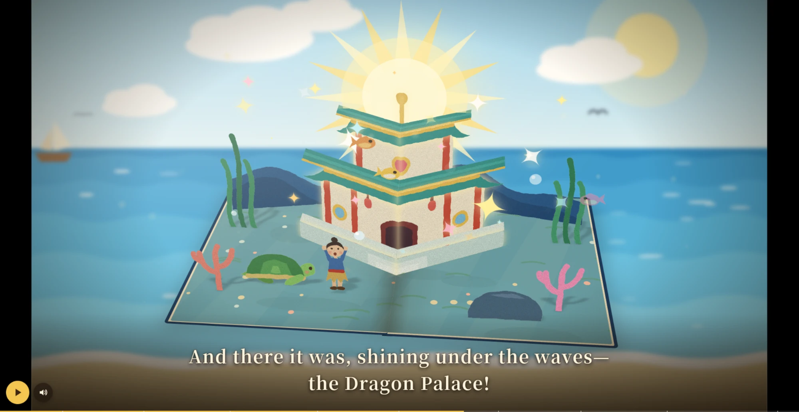

<p align="center">
  
  
</p>

# tobidas-lite

[日本語](README.md) | English

A skill that turns a story into an interactive pop-up book in HTML. It is meant to be loaded into AI coding environments such as Claude Code and Codex. The recommended model is Claude Fable 5.2.

A book opens on a desk, or in front of a moving landscape such as a seaside or a forest. Each time a page turns, paper-cut parts stand up in 3D. You scroll the mouse wheel to move forward and back, or press the play button to watch it with music and sound effects.

## Concept

tobidas-lite is derived from [tobidas](https://github.com/jun76/tobidas).

| | tobidas | tobidas-lite |
|---|---|---|
| Form | Web app | Skill for an agent |
| Material | Images, audio, video, narration | SVG pictures and sound synthesized in the browser (your own image and audio files can also be used) |
| Preparation | Assets must be prepared in advance | None (prepare assets only if you want to use them) |

The goal of tobidas-lite is that **you give an agent the URL of this repository and the story you want, and a finished book comes out**. To make that possible, pictures and sound are limited to what an agent can write as code.

## Features

- No assets are needed. Pictures are SVG, the 3D is CSS 3D transforms, the music and sound effects are synthesized in the browser, and no external libraries are used.
- You can optionally use your own image and audio files. Put them in the book's `assets/` folder and they are built in as characters, backgrounds, music or sound effects.
- The output is a single book folder. `index.html` opens without a server.
- The text inside the book (title, captions, signs) can be in the language you choose.

## Examples

Finished books are included, all made with this skill. The model used for each book is listed below. Open a link in the table to view the book right in your browser. If you clone the repository, open the `index.html` of each book.

| Book | Language | Spreads | Look (art style / background / music) | Made by | Notes |
|---|---|---|---|---|---|
| [`examples/jack`](https://jun76.github.io/tobidas-lite/skills/tobidas-lite/themes/storybook/examples/jack/) — Jack and the Beanstalk | Japanese | 8 | Paper-cut / wooden desk / music box | Claude Fable5.2 medium | Minor adjustments over a few turns |
| [`examples/urashima`](https://jun76.github.io/tobidas-lite/skills/tobidas-lite/themes/storybook/examples/urashima/) — Urashima Taro | English | 8 | Crayon / moving seaside / Japanese flute | Claude Opus 5.5 medium | Minor adjustments over a few turns |
| [`examples/alice`](https://jun76.github.io/tobidas-lite/skills/tobidas-lite/themes/storybook/examples/alice/) — Alice's Adventures in Wonderland | Japanese | 6 | Flat / original backgrounds / fife and drum | GPT-6 Astra medium | Created in one turn |
| [`examples/saiyuki`](https://jun76.github.io/tobidas-lite/skills/tobidas-lite/themes/storybook/examples/saiyuki/) — 西游记 (Journey to the West) | Chinese | 6 | Pixel art / original backgrounds / chiptune | GPT6.1-Sol medium | Created in one turn |
| [`examples/momotaro`](https://jun76.github.io/tobidas-lite/skills/tobidas-lite/themes/storybook/examples/momotaro/) — Momotaro | English | 8 | Pop art / moving meadow / Japanese flute | Qwen 3.8 Flash Next IQ3_S xhigh (Strata) | Minor adjustments over a few turns. Local LLM reference implementation |

<details>
<summary>Other books</summary>

| Book | Language | Spreads | Look (art style / background / music) | Made by | Notes |
|---|---|---|---|---|---|
| [`examples/bremen`](https://jun76.github.io/tobidas-lite/skills/tobidas-lite/themes/storybook/examples/bremen/) — Die Bremer Stadtmusikanten (The Town Musicians of Bremen) | German | 6 | Paper-cut / original backgrounds / original score | GPT-6.2 Astra medium | Created in one turn |
| [`examples/sarukani`](https://jun76.github.io/tobidas-lite/skills/tobidas-lite/themes/storybook/examples/sarukani/) — さるかに がっせん (The Crab and the Monkey) | Japanese | 8 | Paper-cut / original backgrounds / Japanese flute | GPT-6.2 Astra Max | Created in one turn |

</details>

The examples are under `skills/tobidas-lite/themes/storybook/`.

### Controls

| Input | Action |
|---|---|
| Mouse wheel | Forward / back |
| ← → | Move one spread |
| ▶ button (bottom left) or Space | Autoplay with sound, from the current position |
| M | Sound on / off |
| D | Debug display |
| Dropdowns (top left) | Switch the art style, backdrop and music (reloads and returns to the same position) |

## Getting started

Give your agent the URL of this repository and the book you want.

> Use https://github.com/jun76/tobidas-lite to make a pop-up book of Momotaro.

The agent fetches the repository and follows the procedure in `skills/tobidas-lite/SKILL.md`. The check and video scripts need Node.js and Chrome.

### Installing it as a skill

If you use it often, you can install it as a skill.

Copy `skills/tobidas-lite/` into the skills folder of your environment. For Claude Code that is `~/.claude/skills/`; for other environments, use the folder they read skills from.

```bash
git clone https://github.com/jun76/tobidas-lite.git
```

```bash
cp -r tobidas-lite/skills/tobidas-lite ~/.claude/skills/
```

If your environment has no skills folder, put `skills/tobidas-lite/` anywhere in your workspace and tell the agent to read its `SKILL.md`.

The check and export scripts need Node.js and Chrome. Install their dependency once (adjust the path to where you copied the skill):

```bash
cd ~/.claude/skills/tobidas-lite/scripts && npm install
```

## What the agent does

Once asked, the agent works through these steps:

1. **Interview.** From the story, it builds a setup page. You open it in a browser, look at the previews, and choose the language used inside the book, the length (4, 6 or 8 spreads), the scene you most want to stand out, whether to use your own image or audio files, how the things in the book are drawn (ready-made parts only, all drawn for this book, or both), and the look and sound (art style, desk or background, music). Then you paste the result into the chat.
2. **Outline.** It shows a table with one row per spread (scene, parts that stand up, motion, sound, caption) and waits for your approval.
3. **Build.** It writes the pictures and the scene definitions for that book on top of the bundled engine and theme.
4. **Check.** It captures frames with a script, looks at them, and fixes what is wrong.
5. **Hand over.** You get a folder with `index.html`. It also tells you what it could not check, such as how the sound actually sounds.

## Themes

The look and sound live in a folder called a theme, which can be swapped. One theme, `storybook`, is included.

| Item | Built-in choices |
|---|---|
| Art style | 10: paper-cut, flat, crayon, retro, neon, risograph, pop art, monochrome, chalkboard, pixel art |
| Desk | 10: wood, light wood, linen, felt, marble, grass, sky, night sky, cutting mat, steel plate |
| Moving background | 5: seaside, meadow, forest, town, retro game |
| Music set | 5: music box, fife and drum, harp, Japanese flute, chiptune |
| Drawing parts | 300: houses, castles, trees, mountains, vehicles, people, animals, furniture, tools, food and more (previews in [`parts/previews/`](skills/tobidas-lite/themes/storybook/parts/previews/)) |

For the desk or background and the music, you either pick a built-in choice or have the agent write a new one for that book. The art style is picked from the built-in choices. Preview images are in [`themes/storybook/previews/`](skills/tobidas-lite/themes/storybook/previews/). The theme format is described in [`references/theme-format.md`](skills/tobidas-lite/references/theme-format.md) (in Japanese).

## Scripts

Run these from `skills/tobidas-lite/`.

```bash
node scripts/new-book.mjs ../my-book --theme storybook
```

Creates a new book folder from the template and the theme.

```bash
node scripts/check.mjs themes/storybook/examples/jack
```

Captures representative frames into one contact sheet, and reports sound errors.

```bash
node scripts/render-video.mjs themes/storybook/examples/jack
```

Exports a video with sound. This one also needs ffmpeg.

## Repository layout

| Path | Contents |
|---|---|
| `skills/tobidas-lite/SKILL.md` | The skill itself (the procedure the agent follows) |
| `skills/tobidas-lite/assets/template/` | Template for a book: `index.html` and `engine/` (book mechanics, controls, sound engine; shared by all themes) |
| `skills/tobidas-lite/assets/setup/` | Template for the setup page |
| `skills/tobidas-lite/themes/<theme>/` | Theme pack: styles, desks, music, sound effects, drawing parts, guides, previews, starter, examples |
| `skills/tobidas-lite/references/` | Guides shared by all themes (book definition API, pitfalls, theme format) |
| `skills/tobidas-lite/scripts/` | `setup.mjs`, `new-book.mjs`, `check.mjs`, `gallery.mjs`, `parts-sheet.mjs`, `embed-audio.mjs`, `bundle.mjs`, `render-video.mjs` |

A book folder consists of `index.html`, `engine/`, `theme/` (a copy of the chosen theme) and `book/` (the pictures and definitions for that book).

The skill's instructions and guides are written in Japanese. The agent follows them whatever language you talk to it in.

## How it works

A book is deterministic: given a time `t`, it draws one frame. Wheel scrolling, the frame check and video export all pass a time to the same render function.

## Notes

- The skill provides the procedure and the routine processing (scripts) an agent needs to make a book. The quality of the book finally depends on the ability of the agent that uses it.
- You can also ask for an art style the skill does not expect. The quality in that case has not been evaluated.
- The skill instructs the agent to report any defects or improvements it found in the skill itself when the book is finished. If you are happy to have your local copy of the skill tuned, approve the proposals as they are.

The following are outside the scope of the skill.

- Using video files as material inside a book. Only image and audio files can be used as material. A finished book can still be exported as a video file (`render-video.mjs`).
- Generating narration (voice). Voice audio files you provide can be played. A `tobidas:time` event also reports the current time so you can add your own playback.

## Tested environments

The books have been checked in the following environments.

| Device | Browsers |
|---|---|
| Windows 11 PC | Chrome, Firefox, Edge |
| Ubuntu 26.04 PC | Chrome, Firefox |
| iPhone 13 | Chrome, Safari |
| MacBook Pro M1 | Chrome, Safari |

If a book runs slowly, add `?lite&nofilter` to its URL (for example `index.html?lite&nofilter`). The decorative layers and the art-style filter are then left out.

In the in-app browsers of AI agent apps, some things may not work reliably. The following two cases have been confirmed.

- In the Claude Code app, the books run slowly.
- In the Muse app for Mac, the sample player on the setup page cannot be used.
- In the Muse app for Chrome (browser extension), the sample player on the setup page cannot be used either; the sample is replaced with the cover poster and a note.

## License

[MIT](LICENSE)
