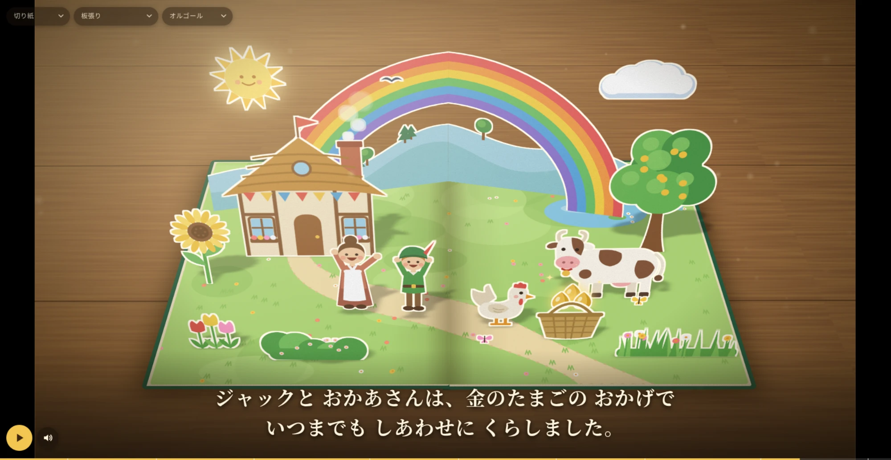
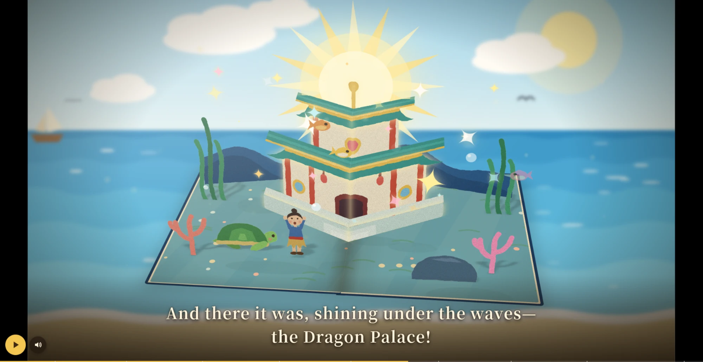

<p align="center">
  
  
</p>

# tobidas-lite

日本語 | [English](README.en.md)

物語から「飛び出す絵本」ふうのインタラクティブなHTML作品を作るスキルです。Claude Code や Codex をはじめとするAIコーディング環境に読み込ませて使います。おすすめのモデルは Claude Fable 5.2 です。

机の上、または海辺や森などの動く景色を背景に本が開き、ページをめくるたびに切り紙のパーツが立体的に立ち上がります。マウスホイールで先送り・巻き戻しができ、再生ボタンを押すとBGMと効果音つきで自動再生します。

## コンセプト

tobidas-lite は [tobidas](https://github.com/jun76/tobidas) から派生したプロジェクトです。

| | tobidas | tobidas-lite |
|---|---|---|
| 形式 | Webアプリ | エージェント用のスキル |
| 扱う素材 | 画像・音声・動画・読み上げ | SVG の絵と、ブラウザ内で合成する音(用意した画像・音声ファイルも使える) |
| 始める前の準備 | 素材(アセット)をあらかじめ用意する | なし(素材を使う場合だけ用意する) |

tobidas-lite が目指しているのは、**このリポジトリのURLと作りたい作品の題材をエージェントに伝えるだけで、絵本が完成すること**です。そのために、絵も音もエージェントがコードとして書ける範囲に絞っています。

## 特徴

- 素材なしで作れます。絵は SVG、立体表現は CSS の 3D transform、BGMと効果音はブラウザ内で合成し、外部ライブラリは使いません。
- 用意した画像・音声ファイルを使うこともできます(任意)。作品フォルダの `assets/` に置き、人物や背景の絵、BGM、効果音として組み込みます。
- 成果物は単一の作品フォルダです。`index.html` はサーバーなしで開けます。
- 作品の中の文字(題字・字幕・看板など)は、選んだ言語で作れます。

## 見本

完成見本を6作品同梱しています。いずれもこのスキルを使って制作したもので、制作モデルは表に記載しています。リポジトリを clone して、それぞれの `index.html` をブラウザで開いてください。

| 作品 | 言語 | 見開き数 | 見た目 | 制作 | 備考 |
|---|---|---|---|---|---|
| [`examples/jack`](skills/tobidas-lite/themes/storybook/examples/jack/): ジャックと豆の木 | 日本語 | 7 | 切り紙、板張りの机 | Claude Fable5.2 medium | 数ターン微調整 |
| [`examples/urashima`](skills/tobidas-lite/themes/storybook/examples/urashima/): Urashima Taro | 英語 | 8 | クレヨン、動く背景の海辺、和風の曲 | Claude Fable5.2 medium | 数ターン微調整 |
| [`examples/alice`](skills/tobidas-lite/themes/storybook/examples/alice/): 不思議な国のアリス | 日本語 | 6 | レトロ、見開きごとに変わる背景 | GPT6.1-Sol medium | 1ターンで作成 |
| [`examples/le-petit-prince`](skills/tobidas-lite/themes/storybook/examples/le-petit-prince/): Le Petit Prince | フランス語 | 6 | レトロ、見開きごとに変わる背景 | Claude Opus 5.5 medium | 1ターンで作成 |
| [`examples/momotaro`](skills/tobidas-lite/themes/storybook/examples/momotaro/): Momotaro | 英語 | 6 | 切り紙、見開きごとに変わる背景 | Qwen3.8 Flash Next Unsloth UD-Q4_K_XL high (Strata) | 1ターンで作成 |
| [`examples/hanasaka-jiisan`](skills/tobidas-lite/themes/storybook/examples/hanasaka-jiisan/): はなさかじいさん | 日本語 | 6 | 切り紙、見開きごとに書き下ろした背景・和風BGM | GPT-6 Astra medium | 1ターンで作成 |

見本は `skills/tobidas-lite/themes/storybook/` の下にあります。

### 操作

| 入力 | 動き |
|---|---|
| マウスホイール | 進む/戻る |
| ← → | 見開き単位で移動 |
| 左下の▶ボタン、または Space | 今の位置から音つきで自動再生 |
| M | 音のオン/オフ |
| D | デバッグ表示 |
| 左下のプルダウン | 画風の切り替え(読み直して同じ位置に戻る) |

## はじめかた

エージェントに、このリポジトリのURLと作りたい作品を伝えます。

> https://github.com/jun76/tobidas-lite を使って、桃太郎の飛び出す絵本を作って。

エージェントがリポジトリを取得し、`skills/tobidas-lite/SKILL.md` の手順に従って制作します。検証と動画化のスクリプトを使う場合は、Node.js と Chrome が必要です。

### スキルとして入れておく場合

何度も使うなら、スキルとして入れておけます。

`skills/tobidas-lite/` をお使いの環境のスキル用フォルダにコピーします。Claude Code なら `~/.claude/skills/` です。ほかの環境では、その環境がスキルを読み込むフォルダに置いてください。

```bash
git clone https://github.com/jun76/tobidas-lite.git
```

```bash
cp -r tobidas-lite/skills/tobidas-lite ~/.claude/skills/
```

スキル用フォルダがない環境では、`skills/tobidas-lite/` を作業フォルダのどこかに置き、エージェントに `SKILL.md` を読むよう伝えてください。

検証と書き出しのスクリプトには Node.js と Chrome が必要です。初回だけ依存パッケージを入れます(パスはスキルを置いた場所に合わせてください)。

```bash
cd ~/.claude/skills/tobidas-lite/scripts && npm install
```

## 制作の流れ

頼まれたエージェントは次の順で進めます。

1. 聞き取り: 題材をもとに聞き取りページを作ります。ブラウザで開き、見本を見ながら作中の言語、長さ(見開き4・6・8)、いちばん見せたい場面、素材の有無、見た目と音(画風、机または背景、曲)を選んで、結果を会話に貼ります。
2. 構成表: 見開きごとに1行(場面、立ち上がるパーツ、動き、音、字幕)の表を見せ、了承を待ちます。
3. 制作: 同梱のエンジンとテーマの上に、その作品だけの絵と場面定義を書きます。
4. 確認: スクリプトでフレームを撮り、画像を見て、崩れているところを直します。
5. 引き渡し: `index.html` の入ったフォルダを渡します。音の聞こえ方など、確認できなかった点も伝えます。

## テーマ

見た目と音の素材は「テーマ」というフォルダ単位でまとまっていて、差し替えられます。同梱しているのは `storybook`(童話の絵本)です。

| 項目 | 内蔵の選択肢 |
|---|---|
| 画風 | 4種: 切り紙、フラット、クレヨン、レトロ |
| 机 | 9種: 板張り、白木、麻布、フェルト、大理石、芝生、青空、星空、カッティングマット |
| 動く背景 | 4種: 海辺、草原、森、市街 |
| 曲集 | 4種: オルゴール、行進曲、子守歌、和風 |

机・背景と曲は、内蔵から選ぶか、その作品のためにエージェントに書き下ろしてもらうかを決められます。画風は内蔵から選びます。見本画像は [`themes/storybook/previews/`](skills/tobidas-lite/themes/storybook/previews/) に、テーマの書式は [`references/theme-format.md`](skills/tobidas-lite/references/theme-format.md) にあります。

## スクリプト

`skills/tobidas-lite/` で実行します。

```bash
node scripts/new-book.mjs ../my-book --theme storybook
```

ひな形とテーマから、新しい作品フォルダを作ります。

```bash
node scripts/check.mjs themes/storybook/examples/jack
```

代表フレームを撮って一覧画像にまとめ、音の間違いも報告します。

```bash
node scripts/render-video.mjs themes/storybook/examples/jack
```

音つきの動画を書き出します。これだけ ffmpeg も必要です。

## リポジトリの構成

| 場所 | 内容 |
|---|---|
| `skills/tobidas-lite/SKILL.md` | スキル本体(エージェントが従う手順) |
| `skills/tobidas-lite/assets/template/` | 作品のひな形。`index.html` と `engine/`(本の機構・操作・音源。全テーマ共通) |
| `skills/tobidas-lite/assets/setup/` | 聞き取りページのひな形 |
| `skills/tobidas-lite/themes/<テーマ>/` | テーマパック。画風・机・曲・効果音・絵の部品、資料、見本画像、書き出し、完成見本 |
| `skills/tobidas-lite/references/` | 全テーマ共通の資料(作品定義の書き方、落とし穴、テーマの書式) |
| `skills/tobidas-lite/scripts/` | `setup.mjs`、`new-book.mjs`、`check.mjs`、`gallery.mjs`、`embed-audio.mjs`、`render-video.mjs` |

作品フォルダは `index.html`、`engine/`、`theme/`(選んだテーマのコピー)、`book/`(その作品の絵と定義)でできています。

## しくみ

作品は「時刻 `t` を渡すと1フレームを描く」決定的な作りです。ホイール操作、静止画チェック、動画化は、どれも同じ描画関数に時刻を渡しているだけです。

## 注意事項

- このスキルが提供するのは、エージェントが作品を作るための手順と定型処理(スクリプト)です。作品の出来は最終的にはスキルを使うエージェントの能力に左右されます。
- スキルが想定していない作風を指示することもできます。ただし、その場合の出来は評価していません。
- 制作中に見つかったスキル側の不備や改善点は、完成時にエージェントからユーザーへ提案されます(そうするようスキルが指示しています)。手元のスキルを調整してよければ、そのまま承認してください。

次のものはスキルの範囲外です。

- 動画ファイル。
- 読み上げ(声)の生成。用意した声の音声ファイルを鳴らすことはできます。後付けできるように、現在時刻を通知する `tobidas:time` イベントも用意しています。

## ライセンス

[MIT](LICENSE)
